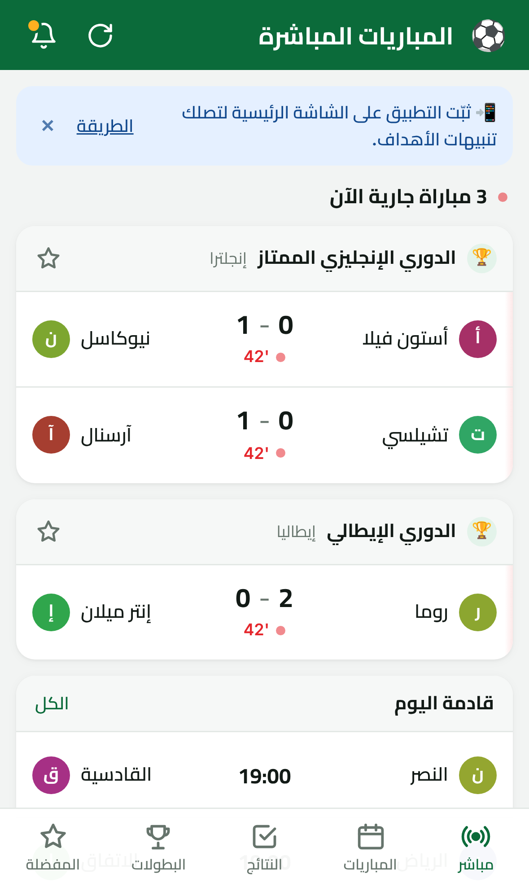
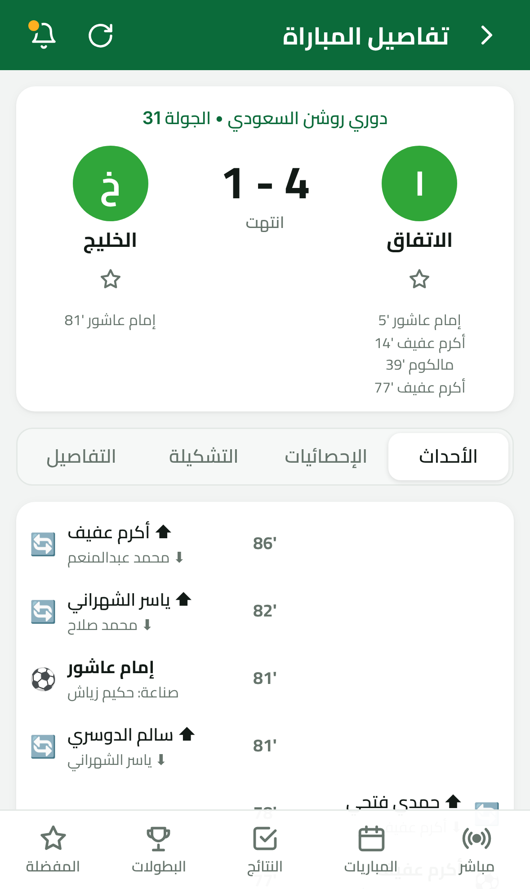
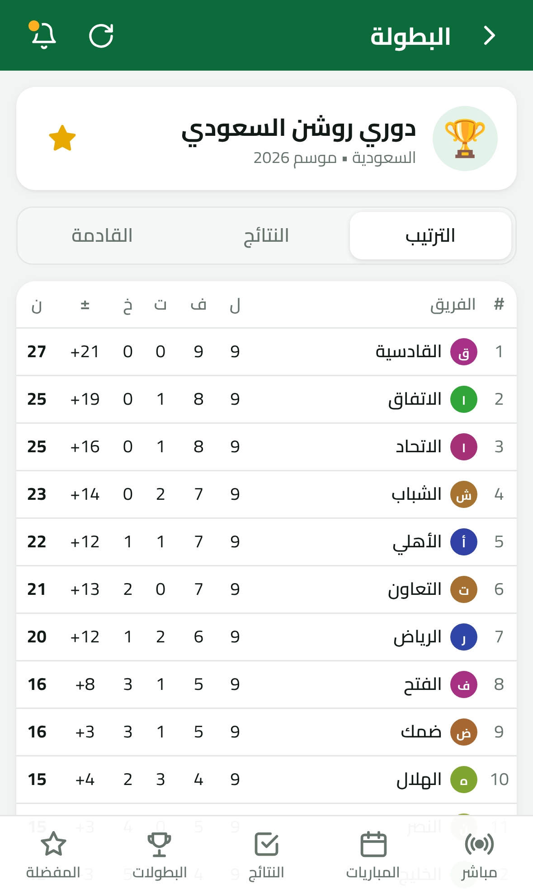
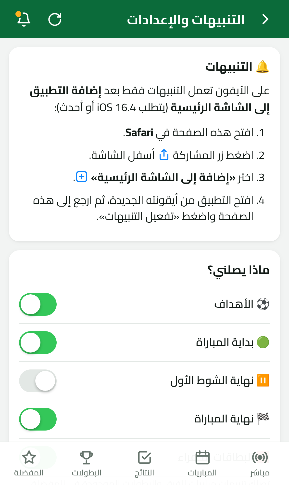

<div dir="rtl">

# ⚽ كورة لايف — نتائج ومباريات كرة القدم مباشرة (PWA للآيفون)

تطبيق ويب تقدّمي (PWA) **بالعربية** يُثبَّت على الآيفون من Safari ويعمل كتطبيق كامل الشاشة:
نتائج مباشرة، جدول المباريات، النتائج، جداول الترتيب، تفاصيل كل مباراة، و**تنبيهات فورية** للأهداف وبداية ونهاية المباريات.

| المباشر | تفاصيل المباراة | الترتيب | التنبيهات |
|---|---|---|---|
|  |  |  |  |

## المزايا

- **مباشر**: المباريات الجارية الآن مع الدقيقة والنتيجة، تتحدث تلقائياً.
- **المباريات**: جدول اليوم وحتى 7 أيام قادمة، مع شريط لاختيار اليوم.
- **النتائج**: نتائج اليوم وآخر 7 أيام.
- **البطولات**: جدول الترتيب، آخر النتائج، والمباريات القادمة لكل بطولة.
- **تفاصيل المباراة**: الأهداف والبطاقات والتبديلات، الإحصائيات، التشكيلة، الملعب والحكم.
- **المفضلة**: فرقك وبطولاتك تظهر أولاً، مع فلتر «المفضلة».
- **التنبيهات (Web Push)**: ⚽ هدف، 🟢 بداية المباراة، ⏸️ نهاية الشوط الأول، 🏁 نهاية المباراة، 🟥 بطاقة حمراء، و ❌ إلغاء هدف. تختار أنت نوع التنبيهات.
- واجهة من اليمين لليسار بخط **Cairo**، ووضع داكن تلقائي، ومراعاة النوتش وشريط الآيفون السفلي.
- يعمل **دون إنترنت** بعرض آخر بيانات محفوظة.
- الأوقات بتوقيت جهازك تلقائياً.

## طريقة العمل

```
 الآيفون (PWA)                       Cloudflare Worker (مجاني)                      مزوّد البيانات
┌──────────────────┐   /api/*    ┌─────────────────────────────────┐   HTTPS   ┌──────────────────┐
│ React + Service  │ ──────────▶ │ واجهة API + ذاكرة مؤقتة (D1)    │ ────────▶ │ API-Football     │
│ Worker (Workbox) │ ◀────────── │ مهمة كل دقيقة (Cron):            │           │ أو بيانات تجريبية │
│ يستقبل التنبيهات │ ◀── Push ── │  تكتشف الأهداف وترسل التنبيهات   │           └──────────────────┘
└──────────────────┘             └─────────────────────────────────┘
```

- **مفتاح الـ API مخفي** داخل الخادم ولا يصل إلى التطبيق.
- **طلب واحد يخدم كل المستخدمين**: الردود تُحفظ في قاعدة D1، والمتابعة المباشرة تتم مرة واحدة على الخادم لا من كل جوال.
- الخادم **لا يستهلك أي طلب** عندما لا توجد مباريات جارية أو على وشك البدء.
- التنبيهات مبنية على معيار Web Push (VAPID + تشفير aes128gcm) وتعمل مع خدمة Apple على الآيفون.

## هيكل المشروع

```
app/       تطبيق الـ PWA (Vite + React + TypeScript)
  src/pages/        الصفحات: مباشر، المباريات، النتائج، البطولات، المباراة، المفضلة، الإعدادات
  src/sw.ts         Service Worker: العمل دون إنترنت + استقبال التنبيهات
  src/lib/push.ts   تفعيل التنبيهات ومزامنة المفضلة مع الخادم
worker/    خادم Cloudflare Worker
  src/providers/    مزوّدو البيانات: api-football و mock (تجريبي)
  src/notify.ts     اكتشاف الأحداث (هدف، بداية، نهاية...) وصياغة التنبيه بالعربية
  src/push/         تنفيذ Web Push
  migrations/       جداول قاعدة البيانات D1
shared/    أنواع مشتركة + أسماء البطولات والفرق بالعربية
```

## التشغيل محلياً

يتطلب Node.js 20 أو أحدث.

```bash
npm install
npm run vapid --workspace worker -- --dev      # مفاتيح التنبيهات للتجربة المحلية (worker/.dev.vars)
npm run db:migrate:local --workspace worker    # إنشاء الجداول محلياً
npm run dev                                    # يبني التطبيق ثم يشغّل الخادم (8787) و Vite (5173)
```

افتح `http://localhost:5173` للتطوير. لتجربة الـ Service Worker والتنبيهات افتح النسخة المبنية على `http://localhost:8787`، فالـ Service Worker لا يعمل في وضع التطوير. يعمل التطبيق افتراضياً بـ**بيانات تجريبية** (`PROVIDER=mock`): مباريات تتقدّم مع الوقت الحقيقي، فيها أهداف وبطاقات واستراحة ونهاية، فيمكنك تجربة كل شيء بما فيه التنبيهات دون مفتاح API.

الاختبارات وفحص الأنواع:

```bash
npm test          # اختبارات الخادم (التشفير، اكتشاف الأهداف، تحويل بيانات API-Football...)
npm run typecheck
```

## النشر على Cloudflare (مجاناً)

```bash
cd worker
npx wrangler login
npx wrangler d1 create football          # انسخ database_id الناتج إلى wrangler.jsonc
npm run db:migrate:remote

npm run vapid                             # يطبع مفتاحَي VAPID
npx wrangler secret put VAPID_PUBLIC_KEY
npx wrangler secret put VAPID_PRIVATE_KEY

cd .. && npm run deploy                   # يبني التطبيق وينشره مع الخادم
```

ستحصل على رابط مثل `https://koora-live.<حسابك>.workers.dev`، وهو رابط التطبيق الذي تفتحه على الآيفون.

قبل النشر عدّل في `worker/wrangler.jsonc`:
- `VAPID_SUBJECT`: بريدك الإلكتروني بصيغة `mailto:you@example.com`، فخدمة Apple تشترطه.

### تفعيل البيانات الحقيقية (API-Football)

1. سجّل في [api-football.com](https://www.api-football.com/) واحصل على مفتاحك.
2. `npx wrangler secret put API_FOOTBALL_KEY`
3. في `worker/wrangler.jsonc` غيّر `"PROVIDER": "api-football"`، وعدّل `DAILY_REQUEST_LIMIT` حسب خطتك، ثم أعد النشر.

> ⚠️ **مهم بخصوص الخطة المجانية (100 طلب يومياً):**
> - تقيّد API-Football الخطة المجانية بمواسم محددة، وقد **لا تتيح الموسم الحالي**. يظهر ذلك في التطبيق كرسالة خطأ من المزوّد. جرّب مفتاحك أولاً.
> - 100 طلب يومياً لا تكفي لتحديث كل دقيقة. ضع `LIVE_POLL_SECONDS` على `600` تقريباً (تحديث كل 10 دقائق) لتكفي ليوم مباريات، وسيتأخر التنبيه حتى 10 دقائق.
> - للتنبيهات الفورية (خلال دقيقة) تحتاج خطة مدفوعة (مثل Pro بحدود 7,500 طلب يومياً)، ثم ضع `DAILY_REQUEST_LIMIT` على `7500` و `LIVE_POLL_SECONDS` على `60`.
>
> الخادم يحجز 15 طلباً يومياً لتصفّح التطبيق، ويعرض آخر نسخة محفوظة عند انتهاء الحد.

## التثبيت على الآيفون وتفعيل التنبيهات

1. افتح رابط التطبيق في **Safari**.
2. اضغط زر **المشاركة** ثم **«إضافة إلى الشاشة الرئيسية»**.
3. افتح التطبيق **من أيقونته** على الشاشة الرئيسية.
4. اذهب إلى 🔔 (أعلى الشاشة) ثم اضغط **«تفعيل التنبيهات»** ووافق على الإذن.
5. أضف فرقك وبطولاتك من **المفضلة**: النجمة ★ في صفحة المباراة، أو اضغط على اسم الفريق في جدول الترتيب.
6. اضغط **«إرسال تنبيه تجريبي»** للتأكد.

> تنبيهات تطبيقات الويب على الآيفون تتطلب **iOS 16.4 أو أحدث**، ولا تعمل إلا بعد إضافة التطبيق إلى الشاشة الرئيسية. هذا قيد من Apple.

## التخصيص

- **البطولات**: `shared/leagues.ts`. أضف المعرّف (id) من API-Football والاسم العربي.
- **أسماء الفرق بالعربية**: `shared/teams.ts`. أي فريق غير موجود يظهر باسمه الإنجليزي.
- **الألوان والمظهر**: المتغيرات في أعلى `app/src/styles/app.css`.
- **الأيقونة**: عدّل `scripts/icon.svg` ثم `npm run icons`.

## واجهة الخادم (API)

| المسار | الوصف |
|---|---|
| `GET /api/meta` | المزوّد، البطولات، مفتاح VAPID العام، استهلاك الطلبات |
| `GET /api/live` | المباريات الجارية |
| `GET /api/matches?date=YYYY-MM-DD&tz=Asia/Riyadh` | مباريات يوم محلي |
| `GET /api/match/:id` | تفاصيل مباراة (أحداث، إحصائيات، تشكيلة) |
| `GET /api/standings/:leagueId` | جدول الترتيب |
| `GET /api/league/:leagueId/matches` | آخر 10 نتائج وأقرب 10 مباريات |
| `POST /api/push/subscribe` | تسجيل/تحديث اشتراك التنبيهات والمفضلة |
| `POST /api/push/unsubscribe` | إلغاء الاشتراك |
| `POST /api/push/test` | إرسال تنبيه تجريبي |

## حدود معروفة

- الخطة المجانية في Cloudflare Workers تسمح بـ50 طلباً خارجياً لكل تشغيل، أي بضع عشرات من التنبيهات في الدقيقة. هذا يكفي للاستخدام الشخصي أو لمجموعة صغيرة. لعدد مستخدمين كبير استخدم الخطة المدفوعة (5$ شهرياً).
- البيانات التجريبية عشوائية لكنها ثابتة، فقد يتكرر لاعب أو فريق بشكل غير واقعي.

</div>
